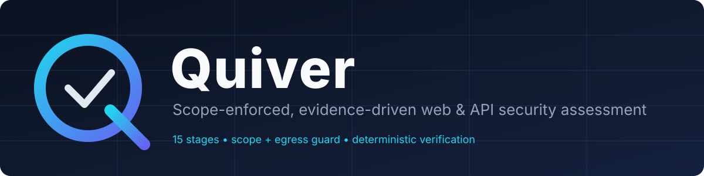
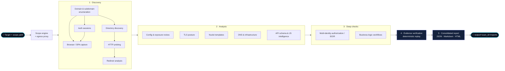
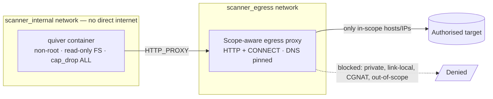

<p align="center">
  
</p>

<p align="center">
  
  
  
  
  
</p>

<h1 align="center">Quiver</h1>
<p align="center"><b>Q</b>uiver is a scope-enforced, evidence-driven web application and API security assessment pipeline.<br>
It discovers, analyses, verifies and reports — and refuses to go outside the scope you authorise.</p>

> [!WARNING]
> **Authorised testing only.** Run Quiver only against systems you own or have **explicit written permission** to test.
> Configure `config/scope.yaml` before every scan. A configuration flag is not a substitute for OS- or network-level isolation.

---

## Table of contents

1. [Features](#features)
2. [How it works (workflow)](#how-it-works-workflow)
3. [Tools used](#tools-used)
4. [Quick start (step by step)](#quick-start-step-by-step)
5. [Other installation options](#other-installation-options)
6. [Configuration](#configuration)
7. [Usage](#usage)
8. [Output and reports](#output-and-reports)
9. [Architecture and egress safety](#architecture-and-egress-safety)
10. [Project structure](#project-structure)
11. [Development and testing](#development-and-testing)
12. [Troubleshooting](#troubleshooting)
13. [Contributing and disclaimer](#contributing-and-disclaimer)

---

## Features

| | Capability | What it means |
|---|---|---|
| 🎯 | **Scope enforcement** | Every URL, redirect, host, port and resolved IP is checked against `scope.yaml`. DNS is pinned to prevent rebinding. |
| 🛡️ | **Egress isolation** | All traffic goes through a scope-aware proxy (HTTP + HTTPS `CONNECT`) on an internal-only Docker network. |
| 🗂️ | **Per-scan workspaces** | State, artifacts, evidence and reports live under `output/<scan_id>/`. |
| ♻️ | **Resume and provenance** | Stage dependencies, fingerprints and artifact schemas are validated before any result is reused. |
| 🧭 | **Endpoint inventory** | Discovery, browser capture, OpenAPI/GraphQL and JavaScript analysis feed one canonical inventory. |
| 👥 | **Isolated identities** | Multiple test users are kept separate for authorization / IDOR testing. |
| 🔒 | **Non-destructive deep checks** | State-changing probes are off. IDOR claims need explicit ownership evidence. |
| ✅ | **Evidence-first verification** | Findings are replayed and labelled *confirmed*, *false positive* or *needs human review*. Evidence is SHA-256 checked. |
| 🤖 | **Advisory AI triage** | Off by default. AI can never promote a finding or override deterministic verification. |
| ⏱️ | **Resource budgets** | Request counts, concurrency, processes, response sizes and scan time are all bounded. |
| 📄 | **Reports** | JSON, Markdown and HTML, with a coverage ledger showing what was *not* tested. |

---

## How it works (workflow)



### The 15 stages

| # | Stage ID | Title | Phase | Needs |
|--:|---|---|---|---|
| 1 | `domain_enumeration` | Domain & Subdomain Enumeration | Discovery | — |
| 2 | `auth_session_lifecycle` | Authentication & Isolated Session Lifecycle | Discovery | 1 |
| 3 | `browser_capture` | Playwright Application & SPA Capture | Discovery | 1, 2 |
| 4 | `directory_discovery` | Directory & Content Discovery | Discovery | 1 |
| 5 | `http_probing` | HTTP Service Probing | Discovery | 1, 4 |
| 6 | `redirect_analysis` | Redirect Chain & Boundary Analysis | Discovery | 5 |
| 7 | `security_review` | Configuration & Exposure Review | Analysis | 6 |
| 8 | `online_security_checks` | TLS & Transport Security Posture | Analysis | 6 |
| 9 | `nuclei_assessment` | Nuclei Template Vulnerability Scan | Analysis | 2, 6 |
| 10 | `server_dns_checks` | DNS & Infrastructure Posture Checks | Analysis | 1 |
| 11 | `api_js_intelligence` | API Schema & JavaScript Intelligence | Analysis | 3, 6 |
| 12 | `authorization_idor` | Multi-Identity Authorization & IDOR Analysis | Deep checks | 2, 11 |
| 13 | `business_logic_checks` | Stateful Workflow & Business Logic Analysis | Deep checks | 2, 11 |
| 14 | `evidence_verification` | Deterministic Replay & Evidence Verification | Verification | 7–13 |
| 15 | `consolidated_reporting` | Consolidated Assessment Reporting | Reporting | 14 |

Stage outcomes: `SUCCESS`, `PARTIAL` (valid output, incomplete coverage), `FAILED`, `SKIPPED`. A missing optional tool makes a stage `PARTIAL` or `SKIPPED` — it never fakes a result.

---

## Tools used

**Python libraries:** `PyYAML`, `requests`, `urllib3`, `playwright` (optional), `pytest` (dev).

**External security tools** (all pre-installed and version-pinned in the Docker image):

| Tool | Used for | Stage(s) |
|---|---|---|
| [subfinder](https://github.com/projectdiscovery/subfinder), [amass](https://github.com/owasp-amass/amass), [assetfinder](https://github.com/tomnomnom/assetfinder), [BBOT](https://github.com/blacklanternsecurity/bbot) | Subdomain enumeration | 1 |
| [gau](https://github.com/lc/gau), [waybackurls](https://github.com/tomnomnom/waybackurls) | Historical URL discovery | 4 |
| [ffuf](https://github.com/ffuf/ffuf), [feroxbuster](https://github.com/epi052/feroxbuster) | Directory / content discovery | 4 |
| [httpx](https://github.com/projectdiscovery/httpx), [WhatWeb](https://github.com/urbanadam/whatweb), `nmap` | HTTP probing, technology fingerprinting | 5 |
| [katana](https://github.com/projectdiscovery/katana) | Crawling | 3, 4 |
| [Playwright](https://playwright.dev/python/) (Chromium) | SPA / browser capture, screenshots, HAR | 3 |
| [Nuclei](https://github.com/projectdiscovery/nuclei) | Template-based vulnerability scanning | 9 |
| [testssl.sh](https://github.com/testssl/testssl.sh), `openssl` | TLS posture | 8 |
| `dig` (dnsutils), `whois` | DNS and infrastructure checks | 10 |

Run `quiver doctor --profile full-scanner` at any time to see which tools are present.

---

## Quick start (step by step)

Choose **one** path. **Docker is recommended**: it installs *every* tool for you. The Python path installs only the app (no external scanners).

| | 🐳 Path 1 — Docker | 🐍 Path 2 — Python only |
|---|---|---|
| Installs the Python app | ✅ | ✅ |
| Installs scanners (nuclei, subfinder, ffuf, katana, …) | ✅ automatically | ❌ install them yourself |
| Installs Chromium for browser capture | ✅ | optional (`playwright install chromium`) |
| Network isolation through the scope proxy | ✅ | ❌ |
| Best for | Real, authorised scans | Development and running the tests |

### 🐳 Path 1 — Docker (installs everything)

**You need:** Linux, `git`, [Docker Engine](https://docs.docker.com/engine/install/) and the Docker Compose plugin. Check them first:

```bash
docker --version
docker compose version
```

**Install and start — run these lines one at a time:**

```bash
# 1. Download the project
git clone https://github.com/mohit7705/security.git

# 2. Go into the project folder
cd security

# 3. Create the output/ and secrets/ folders with the right permissions (once)
sudo sh scripts/prepare_docker_storage.sh

# 4. Build the image and start the containers.
#    This installs ALL tools (first build takes several minutes).
docker compose up -d --build

# 5. Check that both containers are running (security-analyzer and egress-proxy)
docker compose ps
```

**Make the `quiver` command available (once):**

```bash
# 6. Make the helper script executable
chmod +x scripts/quiver-docker.sh

# 7. Link it so `quiver` works from any folder
sudo ln -s "$PWD/scripts/quiver-docker.sh" /usr/local/bin/quiver

# 8. Verify that every tool was installed
quiver doctor --profile full-scanner
```

> Prefer not to use `sudo ln`? Skip steps 6–7 and run `docker compose exec security-analyzer quiver <arguments>` instead of `quiver <arguments>`.

**Set your scope (required):**

```bash
# 9. Open the scope file and replace example.com with the site you are authorised to test
nano config/scope.yaml

# 10. Restart the proxy so it reads the new scope
docker compose restart egress-proxy
```

**Run a scan:**

```bash
# 11. Scan (the scope file defaults to config/scope.yaml)
quiver -u https://your-authorised-site.com/

# 12. Check progress at any time (the scan ID is printed when the scan starts)
quiver status --scan-id <scan_id>
```

**Find the report:** it is on your computer in `output/<scan_id>/reports/` — open `security_report.html` in a browser.

**Stop or update later:**

```bash
docker compose down                 # stop the containers
docker compose up -d --build        # start again / rebuild after pulling new code
```

### 🐍 Path 2 — Python only (no external scanners)

**You need:** Linux, `git`, `make` and **Python 3.11 or newer**. Check:

```bash
python3 --version
```

**Install — run these lines one at a time:**

```bash
# 1. System packages used by the DNS checks (Debian / Ubuntu / Kali)
sudo apt-get update && sudo apt-get install -y python3 python3-venv python3-pip dnsutils whois curl unzip make git

# 2. Download the project
git clone https://github.com/mohit7705/security.git

# 3. Go into the project folder
cd security

# 4. Create a virtual environment
python3 -m venv .venv

# 5. Activate it (repeat this in every new terminal)
source .venv/bin/activate

# 6. Install Quiver + Playwright + pytest
make install

# 7. (Optional) Download Chromium for browser capture
playwright install chromium

# 8. Verify the install
quiver doctor --profile core-only

# 9. (Optional) Run the test suite
make test
```

**Set your scope (required):**

```bash
# 10. Replace example.com with the site you are authorised to test
nano config/scope.yaml
```

**Run a scan:**

```bash
# 11. Scan (the scope file defaults to config/scope.yaml)
quiver -u https://your-authorised-site.com/

# 12. Check progress
quiver status --scan-id <scan_id>
```

Reports are in `output/<scan_id>/reports/`.

> Scanners such as subfinder, nuclei, ffuf and katana are **not** installed by this path. Stages that need a missing tool finish as `PARTIAL` or `SKIPPED`. Use the Docker path for full coverage.

### Quick command reference

```bash
quiver -help                                         # show help and examples
quiver -u https://site.com/                          # scan (shortest form)
quiver -u https://site.com/ -s config/scope.yaml     # scan with an explicit scope file
quiver https://site.com/                             # bare URL also works
```

---

## Other installation options

### Hardened host deployment (systemd)

For enforced network isolation on a dedicated host (separate service users, nftables egress guard, scope proxy as a service) see [`deploy/README.md`](deploy/README.md) and `scripts/run_security_analyzer_scoped.sh`.

### Docker without a browser

`INSTALL_BROWSER=false docker compose up -d --build` builds a smaller image without Chromium.

### Installing scanners natively

Install subfinder, nuclei, ffuf, katana and the rest by following each project's official instructions, and avoid piping remote installers into a privileged shell. The versions used by the Docker image are pinned in the [`Dockerfile`](Dockerfile).

---

## Configuration

### 1. Scope — `config/scope.yaml` (required)

```yaml
allowed_domains:
  - "example.com"
include_subdomains: true
allowed_schemes: ["http", "https"]
allowed_ports: [80, 443]
excluded_paths:
  - "/logout"
  - "/admin/delete"
allow_private_ips: false
```

Only list what you are explicitly authorised to test. `--target` never widens this list.

### 2. Settings — `config/settings.yaml`

Conservative defaults for timeouts, request budgets, process limits, browser capture, Nuclei, deep checks and AI triage. Highlights:

| Key | Default | Purpose |
|---|---|---|
| `limits.max_total_requests` | `10000` | Hard request budget per scan |
| `limits.requests_per_host_per_sec` | `5` | Rate limit |
| `limits.max_scan_duration_sec` | `14400` | 4-hour ceiling |
| `deep_checks.allow_state_changing_probes` | `false` | Keeps deep checks read-only |
| `ai_triage.enabled` | `false` | Advisory AI, opt-in |

### Better directory discovery (wordlist)

Quiver ships with a small built-in path list. Build the recommended list from SecLists:

```bash
make wordlists        # writes config/wordlists/quiver-directories.txt
```

`config/settings.yaml` points to this file. Quiver reads it from the top and stops at `limits.max_directory_words`
(default 4000, maximum 10000), so sensitive files, API routes and common paths are tried first. Raise
`limits.max_directory_words` and `timeouts.directory_scan_sec` together for a deeper scan.

### 3. Authenticated testing (optional)

```bash
cp config/auth_profiles.example.yaml config/auth_profiles.yaml
export USER_A_TOKEN="…"; export USER_B_TOKEN="…"
```

Use separate test accounts with **known owned resource IDs** so IDOR conclusions are evidence-based. Pass `--auth-profiles config/auth_profiles.yaml` to `scan`.

> Never commit `.env`, `config/auth_profiles.yaml`, tokens, cookies, `secrets/` or `output/`.

### Live progress view

Scans show numbered progress lines on stderr when run without an interactive terminal. In a terminal,
Quiver uses the optional Textual screen with expandable stages, artifact sizes and record counts, and
redacted output previews. Use `--ui auto|tui|plain|off` or set `QUIVER_UI` to choose a mode. Press `e`
to expand all stages, `c` to collapse them, or `q` to request a safe stop. Install the optional UI with
`pip install -e ".[ui]"` when using Python; Docker images include it.

---

## Usage

The commands are the same for Docker (after the `quiver` link from step 7) and Python (with `.venv` active).

```bash
quiver -help                                    # help, options and examples
quiver --version
quiver stages                                   # list the 15 stages
quiver doctor --profile core-only               # or browser-enabled / full-scanner

quiver -u https://example.com/                  # scan (scope defaults to config/scope.yaml)
quiver -u https://example.com/ -s config/scope.yaml
quiver scan --target https://example.com --scope config/scope.yaml --settings config/settings.yaml   # long form

quiver status --scan-id <scan_id>               # progress + coverage
quiver resume --scan-id <scan_id>               # continue an interrupted scan
quiver resume --scan-id <scan_id> --stage api_js_intelligence   # one stage + its prerequisites
quiver report --scan-id <scan_id>               # regenerate reports
quiver diff   --scan-id <new> --baseline <old>  # compare two scans
quiver cleanup --older-than-days 30             # dry run; add --execute to delete
```

**Scan options**

| Option | Meaning |
|---|---|
| `-u`, `--target URL` | Target to assess. It must be inside the scope file. |
| `-s`, `--scope FILE` | Scope policy (default `config/scope.yaml`). |
| `--settings FILE` | Pipeline settings (default `config/settings.yaml`). |
| `--auth-profiles FILE` | Authenticated test identities for IDOR / authorization checks. |
| `--output-root DIR` | Where results are stored (default `output`). |
| `--baseline SCAN_ID` | Compare against an earlier scan. |

`quiver`, `security-analyzer` and `attack` are interchangeable command names.

**Exit codes:** `0` complete · `1` failed / not ready · `2` partial result or CLI/config error · `130` cancelled.
Always read `scan_state.json` and `coverage_summary.json` — a zero exit code alone does not prove full coverage.

---

## Output and reports

```text
output/<scan_id>/
├── meta/                  # redacted config snapshot, tool & environment versions
├── discovery/ inventory/  # hosts, paths, canonical endpoint inventory
├── browser/ analysis/     # crawl routes, auth sessions, intelligence
├── evidence/              # SQLite evidence index + SHA-256 digests
├── reports/
│   ├── security_report.json
│   ├── security_report.md
│   └── security_report.html
├── scan_state.json
└── coverage_summary.json
```

Reports separate **confirmed vulnerabilities**, **confirmed configuration issues**, **likely** findings, **needs-human-review** items and **suppressed false positives**, and list every incomplete stage, skipped check and unavailable tool. A CVSS v3.1 base score is computed only when a complete vector exists — scanner labels are never turned into invented scores.

---

## Architecture and egress safety



- The analyzer container has **no** direct route out; only the proxy does, and it is not published on the host.
- The proxy validates every destination and **connects to the exact IP it validated**, so DNS rebinding cannot swap targets.
- Private, loopback, link-local, multicast and shared (CGNAT) addresses are denied unless explicitly allowed.
- Path exclusions are case-insensitive and ignore `;params`, so `/LOGOUT` and `/logout;x=1` are still excluded.
- Logs and reports pass through a redactor that masks tokens, cookies, JWTs, e-mails and phone numbers.

---

## Project structure

```text
.
├── assets/                  # README banner
├── config/                  # scope, settings, browser, example auth profiles
├── deploy/                  # systemd units + egress deployment guide
├── scripts/                 # Docker storage prep, quiver-docker.sh, egress guard, scoped launcher, benchmarks
├── benchmarks/              # lab ground-truth manifests
├── docs/                    # usage guide, implementation ledger
├── src/security_analyzer/
│   ├── core/                # orchestrator, scope engine, stage registry, workspace, budgets
│   ├── discovery/           # subdomains, directories, probing, redirects, inventory
│   ├── browser/             # Playwright crawler, HAR, screenshots, console monitor
│   ├── authentication/      # identities, sessions, token refresh
│   ├── intelligence/        # OpenAPI, GraphQL, JS bundle analysis
│   ├── scanners/            # headers, TLS, DNS, Nuclei
│   ├── deep_checks/         # IDOR / authorization, business logic, canaries
│   ├── verification/        # replay, evidence store, scoring, CVSS, AI triage
│   ├── reporting/           # JSON / Markdown / HTML
│   ├── utils/ models/
│   ├── egress_proxy.py      # scope-aware HTTP/CONNECT proxy
│   └── cli.py
├── tests/                   # 9 suites: foundation → pipeline release + regressions
├── Dockerfile  docker-compose.yml  Makefile  pyproject.toml
```

---

## Development and testing

```bash
make install        # pip install -e ".[browser,dev]"
make test           # compile + full pytest suite
make benchmark      # offline microbenchmarks (no network)
make ci             # clean, compile, test, build wheel
make docker-build
```

Dependencies are defined once, in `pyproject.toml` (extras: `browser`, `dev`). The Makefile writes bytecode to `build/pycache` so `src/` stays clean (a test checks this).
The offline benchmark scorer is `scripts/benchmark_lab.py`; an opt-in OWASP Juice Shop lab target is available with `docker compose --profile lab up -d`.

---

## Troubleshooting

| Problem | Fix |
|---|---|
| `Destination denied` / scope violation | Add the host to `config/scope.yaml`, then `docker compose restart egress-proxy`. |
| `ModuleNotFoundError: scripts` when running `pytest` | Make sure `pythonpath = ["src", "."]` is set in `pyproject.toml`, or use `python -m pytest`. |
| Stage shows `PARTIAL`/`SKIPPED` | A tool is missing — run `quiver doctor --profile full-scanner`. |
| Permission errors on `output/` or `secrets/` | Re-run `sudo sh scripts/prepare_docker_storage.sh` (container UID 1000). |
| Browser capture disabled | Needs `SECURITY_ANALYZER_PROXY` **and** `SECURITY_ANALYZER_EGRESS_ENFORCED=1` (Compose sets both). |
| `quiver: command not found` (Docker) | Repeat steps 6–7, or use `docker compose exec security-analyzer quiver …`. |
| `quiver: command not found` (Python) | Activate the environment: `source .venv/bin/activate`. |
| `test_no_bytecode_in_source_tree` fails | Run `find src -name __pycache__ -prune -exec rm -rf {} +` once, then `make test`. |
| Local/private lab target blocked | Set `allow_private_ips: true` and `browser.lab_mode: true` — lab use only. |

---

## Contributing and disclaimer

Issues and pull requests are welcome at <https://github.com/mohit7705/security>. Please run `make test` before submitting and never include real credentials, scan output or target data.

Quiver is provided for **lawful, authorised security assessment**. The authors accept no liability for misuse. You are responsible for having permission to test every target you configure.

<p align="center"><sub>Built with Python · Docker · Playwright · ProjectDiscovery tools</sub></p>
